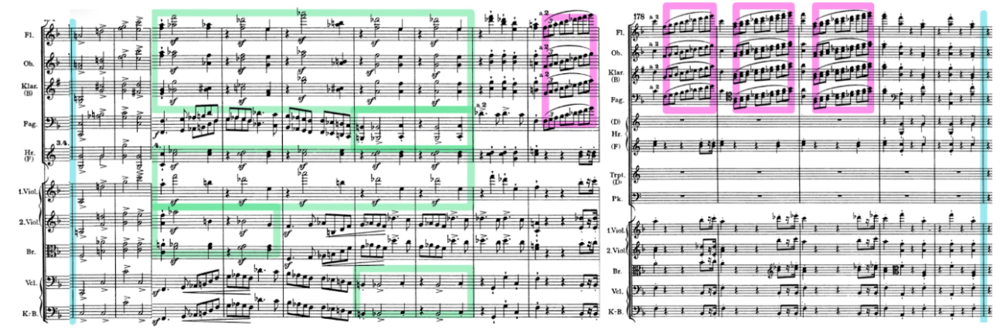
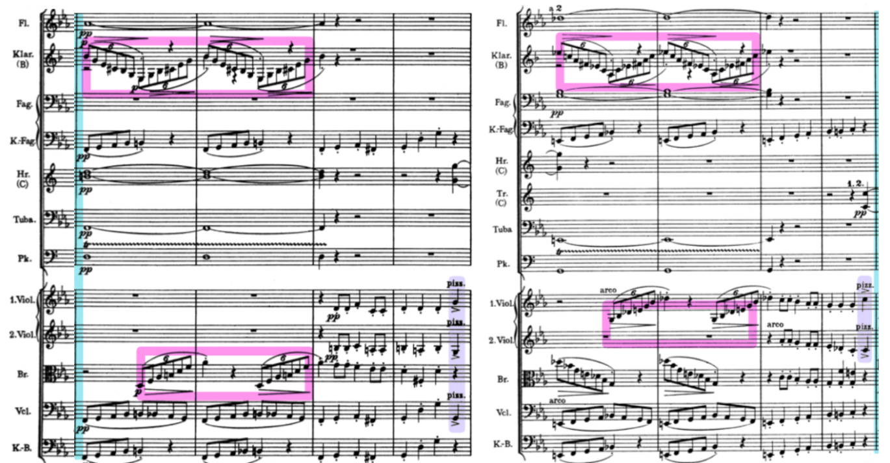
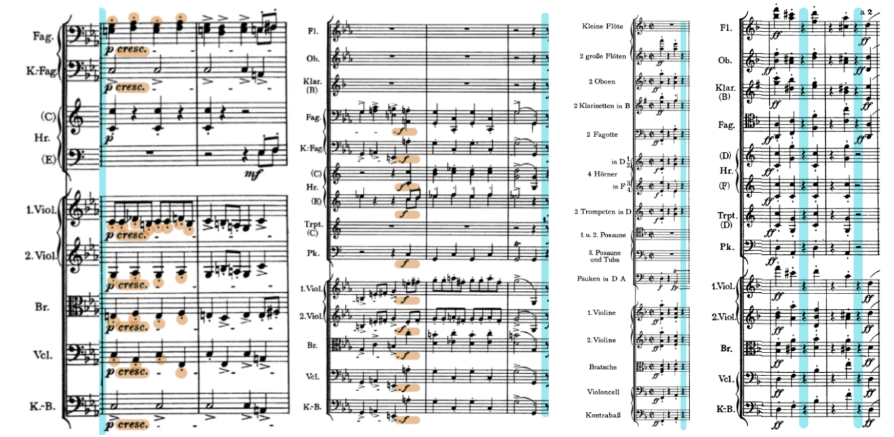
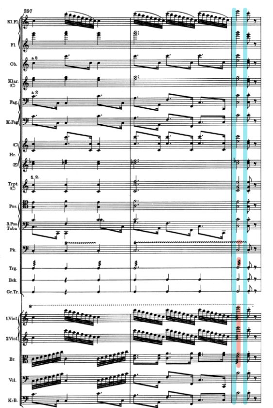

# Variations of *Phèdre*
	
Nietzsche’s ideas of tragedy as a conflict between Dionysian and Apollonian forces is especially prevalent in the tragedy *Phèdre*, where **Phèdre** grapples with the conflict between the Dionysian forces threatening to ruin her life and the Apollonian forces attempting to keep it together. The first scene between **Phèdre** and **Oenone** exemplifies the conflict of these two themes as **Phèdre**, attempting to resist her incestual feelings, is corrupted by **Oenone**’s urging for her to express her feelings out loud. However, their roles can be flipped; instead it could be that **Phèdre**’s Dionysian passion tearing her apart conflicts with **Oenone**’s Apollonian structure trying to keep her calm.

Brahms’s two overtures, the Academic Festival Overture, Op. 80, and the Tragic Overture, Op. 81, present a similar dichotomy of Dionysian vs. Apollonian:

- The structure of the first piece, the Academic Festival Overture, is peculiar and almost humorous, as it quickly transitions between what would be considered appropriate for an academic song to samples of college drinking songs, which strongly connects it to Dionysus, the god of wine. While Brahms initially meant to compose just that overture as a tribute for a university for giving him an honorary doctorate, he didn’t stop there.
- He wrote the second piece in the same summer, inextricably linking the two together himself: “One is laughing, the other crying” (Neunzig). He composed the Tragic Overture in the form of a sonata, which is known for its strict, rounded binary structure, likening it to Nietzsche's Apollonian theme.

By applying Nietzsche’s idea that both Dionysian and Apollonian themes are needed to form a tragedy, a combination of both overtures, then, can be considered a true “tragedy.” How, then, can different interpretations of **Phèdre** lead to different applications of the two themes with the two overtures?

## [Variation One:](https://drive.google.com/file/d/1-JV1pyw3ylBKhMuJ2pEgcsnSzc1nNi99/view?usp=sharing)

In the first variation I made of a blend of Brahms’s overtures, I at first attempted to interpret **Phèdre** as Apollonian and **Oenone** as Dionysian, but I ended up sticking more closely with the text by categorizing certain parts of the dialogue as either Apollonian and Dionysian instead to determine the chronological use of excerpts of each overture. 

Variation One starts with an excerpt from the Tragic Overture in association to the start of the scene when **Phèdre** refers to Apollo with “The sun’s light is too painful” and “You whom my mother dared to call her father… You god of the sun–look at me for the last time” (Racine 10). Forceful offbeats (green highlight) within this first excerpt act as stumbling heartbeats, connecting to **Phèdre**’s feelings of weakness and desperation: “That last scrap of strength has left me suddenly… My wretched, trembling legs cannot support me… Everything conspires to torment me” (10). Meanwhile, ascending triplets (pink highlight) are associated with **Phèdre**’s growing confusion: “Where am I? What am I saying? My mind is strange” (Racine 11). 

*Tragic Overture (mm. 169-182)*

As **Phèdre** starts losing her fight against keeping her emotions in, these triplets transition into an excerpt with even more triplets (pink highlight) from the Academic Festival Overture, revealing her more Dionysian side: “My face feels to be coming apart with all the turmoil” (Racine 11). Though the original score alternates between two measures of triplets and two measures of eighth notes, Variation One overlaps the measures of triplets on the two measures following them. This way, there are no breaks in triplets, indicating that **Phèdre** can’t find reprieve from her emotions. At the same time, she cries, “I can’t control this weeping,” while **Oenone** even urges her to let her emotions go, saying “If you have to weep–then weep” (Racine 11). The strings’ use of the pizzicato technique (purple highlight), where the string is plucked by hand rather than bowed, mimics the “plunk” of **Phèdre**’s tears falling.

*Academic Festival Overture (mm. 17-24)*

**Oenone** continues this trend of frenzy, reprimanding **Phèdre**, “Do you intend to die in this fashion? [...] What right have you to throw away your life?” (Racine 11). This escalation translates to another excerpt from the Academic Festival Overture–one that crescendos (increases in volume) from piano (soft) to forte (loud) and has staccatos (short notes) (brown highlight).

*Academic Festival Overture (mm. 41-45)* and *Tragic Overture (m.1 and mm. 59-60)* 

However, everything changes when **Oenone** utters “Hippolytus” (Racine 12). As **Hippolytus** worships Artemis, twin to Apollo, the next excerpt used in Variation One is thus taken from the Tragic Overture. These minimal but loud, forceful chords make a resounding impact the same way that the mention of a simple name impacts **Phèdre**.

**Phèdre**’s response to this is yelling, “Aaagh!” (Racine 12). This burst of emotions is very Dionysian, as it is a small window into the overwhelming chaos that **Phèdre** feels. Thus, Variation One ends with shrill trilling and tremolos as tremolos (rapidly repeated notes) from the triangle and timpani as well the string instruments (red highlight), producing a screaming effect.

*Academic Festival Overture (m. 399)*

## [Variation Two](https://drive.google.com/file/d/1NdKIfifCp7EeJDS3k6cDnDBlWLIr9Ttm/view?usp=sharing)

In the second variation, I reinterpreted **Phèdre** as Dionysian and **Oenone** as Apollonian and identified three main differences in the mood of the scene to associate with different excerpts from the overtures instead of focusing on the exact words in the text. 
